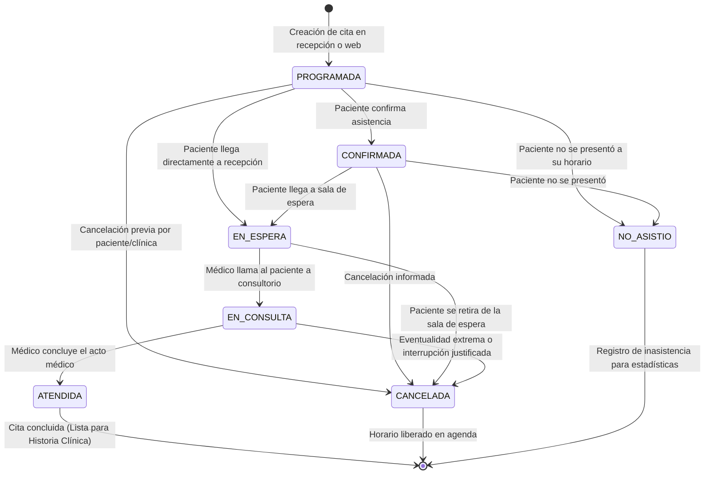

# 03. Módulo de Citas — Arquitectura y Diseño Técnico

Este documento detalla la arquitectura, el modelo de datos relacional, el flujo de estados clínicos y las reglas de gestión de agenda para el **Módulo de Citas** de la plataforma clínica SaaS.

---

## 1. Alcance y Objetivos del Módulo

El módulo de Citas gestiona el flujo operativo de la clínica: desde la reserva inicial de turnos hasta la admisión en recepción y el ingreso a consulta médica. Sus objetivos fundamentales son:

1. **Gestión de Agenda Médica Multi-Tenant:** Cada consultorio u organización gestiona sus propios calendarios médicos, horarios de atención y turnos de manera completamente aislada.
2. **Ciclo de Vida Clínico Determinista:** Una máquina de estados formal que controla las transiciones válidas (`PROGRAMADA` → `CONFIRMADA` → `EN_ESPERA` → `EN_CONSULTA` → `ATENDIDA`), garantizando trazabilidad y previniendo saltos de estado irregulares.
3. **Control Riguroso de Solapamiento (Anti-Overlap):** Algoritmo de validación temporal que impide que un profesional de la salud tenga dos citas superpuestas en el mismo consultorio en horarios concurrentes.
4. **Desacoplamiento e Integración:** Base modular que conectará en Fase 4 directamente con el módulo de Consultas Médicas e Historias Clínicas.

---

## 2. Modelo de Datos de la Entidad `Cita`

La entidad `Cita` hereda de `TenantBaseEntity`, garantizando automáticamente:
- Clave primaria `id` (UUID v4).
- Clave foránea `consultorioId` (UUID) vinculada a la clínica.
- Marcas temporales de auditoría `creadoEn` y `actualizadoEn`.

### 2.1 Campos y Tipos de Datos

| Campo | Tipo PostgreSQL | Requerido | Descripción |
| :--- | :--- | :--- | :--- |
| `id` | `uuid` | Sí | Clave primaria generada automáticamente (UUID v4). |
| `consultorio_id` | `uuid` | Sí | Organización o clínica a la que pertenece la cita (`TenantBaseEntity`). |
| `paciente_id` | `uuid` | Sí | Paciente que recibirá la atención médica (`FK pacientes.id`). |
| `profesional_id` | `uuid` | Sí | Médico o profesional de salud asignado (`FK usuarios.id`). |
| `fecha_hora_inicio` | `timestamp with time zone` | Sí | Fecha y hora exacta de inicio del turno (con zona horaria). |
| `fecha_hora_fin` | `timestamp with time zone` | Sí | Fecha y hora calculada o pactada de finalización. |
| `duracion_minutos` | `integer` | Sí | Duración programada del turno en minutos (por defecto 30). |
| `estado` | `varchar(30)` | Sí | Estado dentro del flujo clínico (`EstadoCita`, default `PROGRAMADA`). |
| `motivo` | `varchar(255)` | Sí | Motivo o razón de la consulta manifestada al agendar. |
| `notas` | `text` | No | Observaciones administrativas, de recepción o indicaciones previas. |
| `motivo_cancelacion` | `text` | No | Razón justificada si la cita pasa a estado `CANCELADA`. |
| `creado_en` | `timestamp with time zone` | Sí | Auditoría de creación en base de datos. |
| `actualizado_en` | `timestamp with time zone` | Sí | Auditoría de última modificación. |

### 2.2 Relaciones Foráneas y Reglas de Integridad

- **Paciente (`pacienteId`)**: Relación `@ManyToOne(() => Paciente, { onDelete: 'RESTRICT' })`. Si un paciente tiene citas registradas en el sistema, no puede ser eliminado de la base de datos para preservar la historia y trazabilidad médico-legal.
- **Profesional (`profesionalId`)**: Relación `@ManyToOne(() => Usuario, { onDelete: 'RESTRICT' })`. Evita eliminar usuarios del sistema que tengan agendas o atenciones históricas asociadas.
- **Consultorio (`consultorioId`)**: Heredado de `TenantBaseEntity` con regla `CASCADE` en caso de baja formal de la suscripción del tenant.

---

## 3. Máquina de Estados del Flujo Clínico

El ciclo de atención del paciente se modela mediante 7 estados estrictamente regulados:



### 3.1 Descripción de Estados

1. **`PROGRAMADA`**: Turno reservado en el calendario. Estado inicial predeterminado.
2. **`CONFIRMADA`**: El paciente o recepción confirmó el turno (por llamada, SMS, WhatsApp o portal).
3. **`EN_ESPERA`**: El paciente se ha presentado físicamente en la recepción de la clínica y se encuentra en sala de espera.
4. **`EN_CONSULTA`**: El profesional de la salud ha iniciado la atención en su consultorio físico o virtual.
5. **`ATENDIDA`**: La consulta médica ha finalizado satisfactoriamente. Este estado conecta directamente con el registro médico en Fase 4.
6. **`CANCELADA`**: La cita fue cancelada antes o durante el proceso. Requiere un motivo explicativo en `motivoCancelacion`. Libera el espacio en agenda.
7. **`NO_ASISTIO`**: El paciente nunca acudió a su turno y expiró la ventana de tolerancia.

---

## 4. Reglas de Validación de Agenda y Solapamiento (Overlap)

### 4.1 Principio de No Solapamiento por Profesional
Un profesional de la salud no puede atender simultáneamente a dos pacientes en el mismo consultorio en horarios que se superpongan:

$$\text{Existe Solapamiento} \iff (\text{NuevaInicio} < \text{ExistenteFin}) \land (\text{NuevaFin} > \text{ExistenteInicio})$$

### 4.2 Excepciones a la Regla de Conflicto
Las citas con estado **`CANCELADA`** o **`NO_ASISTIO`** liberan de forma inmediata el intervalo horario, por lo que **no** generan conflicto si se agenda un nuevo turno en ese mismo horario.

### 4.3 Validación Multi-Tenant Estricta
- El paciente debe pertenecer al mismo `consultorioId`.
- El profesional de la salud debe pertenecer al mismo `consultorioId`.
- Cualquier intento de agendar un paciente o médico perteneciente a otra clínica es rechazado con error `400 Bad Request` o `404 Not Found`.

---

## 5. Índices y Optimización en PostgreSQL 18

Para garantizar tiempos de respuesta inferiores a 5 ms en agendas con miles de registros:

1. **Agenda Diaria/Semanal de la Clínica:**
   ```sql
   CREATE INDEX idx_citas_consultorio_inicio 
   ON citas (consultorio_id, fecha_hora_inicio);
   ```
2. **Detección Rápida de Solapamiento y Agenda Médica Individual:**
   ```sql
   CREATE INDEX idx_citas_profesional_agenda 
   ON citas (consultorio_id, profesional_id, fecha_hora_inicio, fecha_hora_fin);
   ```
3. **Historial de Citas del Paciente (Ficha Médica 360°):**
   ```sql
   CREATE INDEX idx_citas_paciente_historial 
   ON citas (consultorio_id, paciente_id, fecha_hora_inicio);
   ```
4. **Filtros Operativos de Recepción (Sala de Espera y Estados):**
   ```sql
   CREATE INDEX idx_citas_consultorio_estado 
   ON citas (consultorio_id, estado);
   ```

---

## 6. Fases del Módulo de Citas (Roadmap)

- **Tarea 12 (Roadmap 12)**: Diseñar módulo de citas (Arquitectura, modelo relacional `Cita`, estados, índices y módulo base).
- **Tarea 13 (Roadmap 13)**: Crear agendamiento y reprogramación de citas con validación anti-solapamiento.
- **Tarea 14 (Roadmap 14)**: Implementar cambio de estados del flujo de atención clínica (`PROGRAMADA` → `ATENDIDA`).
- **Tarea 15 (Roadmap 15)**: Implementar vista de agenda y filtros de citas (por día, semana, médico y paciente).
