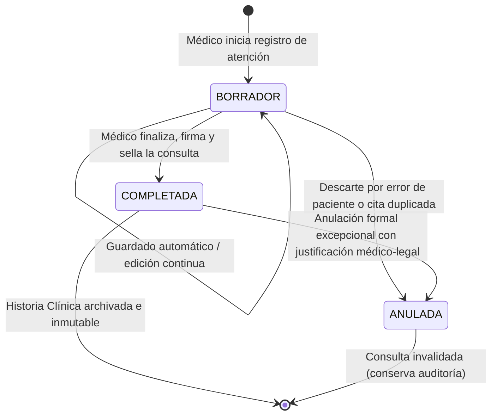

# 04. Módulo de Consultas Clínicas — Arquitectura y Diseño Técnico

Este documento detalla la arquitectura, el modelo de datos relacional, el ciclo de vida del acto médico y las directrices clínicas para el **Módulo de Consultas Clínicas e Historia Clínica** de la plataforma clínica SaaS.

---

## 1. Alcance y Objetivos del Módulo

El módulo de Consultas Clínicas constituye el núcleo de valor asistencial del sistema: digitaliza el **acto médico integral**, la toma de signos vitales, el examen físico, la formulación diagnóstica con codificación internacional (CIE-10) y el plan terapéutico.

Sus objetivos fundamentales son:

1. **Digitalización Integral del Acto Médico:** Registro estructurado y cronológico de la atención: anamnesis, signos vitales, examen físico, diagnóstico y tratamiento.
2. **Vinculación con el Módulo de Citas:** Capacidad de originar una consulta a partir de una cita con estado `EN_CONSULTA` / `ATENDIDA` (relación 1:1), o registrar consultas de urgencia/espontáneas sin cita previa.
3. **Inmutabilidad y Seguridad Médico-Legal:** Ciclo de vida con estados formales (`BORRADOR` → `COMPLETADA` → `ANULADA`). Una vez completada, la consulta médica queda bloqueada para edición, preservando la validez legal del expediente.
4. **Biometría y Cálculo Dinámico:** Cálculo automático del Índice de Masa Corporal (IMC) y estratificación de riesgo según la Organización Mundial de la Salud (OMS).
5. **Codificación Estándar CIE-10:** Estandarización diagnóstica internacional que facilita búsquedas epidemiológicas y futuras estadísticas de morbilidad.
6. **Aislamiento Multi-Tenant Estricto:** Toda consulta pertenece obligatoriamente a un `consultorioId`, impidiendo cualquier fuga de información médica confidencial entre clínicas.

---

## 2. Modelo de Datos de la Entidad `Consulta`

La entidad `Consulta` hereda de `TenantBaseEntity`, garantizando:
- Clave primaria `id` (UUID v4).
- Clave foránea `consultorioId` (UUID) vinculada al tenant.
- Marcas temporales de auditoría `creadoEn` y `actualizadoEn`.

### 2.1 Campos y Tipos de Datos

| Campo | Tipo PostgreSQL | Requerido | Descripción |
| :--- | :--- | :--- | :--- |
| `id` | `uuid` | Sí | Clave primaria generada automáticamente (UUID v4). |
| `consultorio_id` | `uuid` | Sí | Identificador de la clínica (`TenantBaseEntity`). |
| `paciente_id` | `uuid` | Sí | Paciente evaluado (`FK pacientes.id`). |
| `profesional_id` | `uuid` | Sí | Médico que realizó la atención (`FK usuarios.id`). |
| `cita_id` | `uuid` | No | Cita origen vinculada (`FK citas.id`). Opcional para urgencias sin cita. |
| `fecha_atencion` | `timestamp with time zone` | Sí | Momento exacto de realización de la consulta médica. |
| `estado` | `varchar(30)` | Sí | Estado del registro médico (`EstadoConsulta`, default `BORRADOR`). |
| **Anamnesis** | | | |
| `motivo_consulta` | `varchar(255)` | Sí | Razón principal manifestada por el paciente al facultativo. |
| `enfermedad_actual` | `text` | No | Relato cronológico y detallado de la sintomatología actual. |
| **Signos Vitales y Biometría** | | | |
| `peso_kg` | `numeric(5,2)` | No | Peso corporal en kilogramos (ej. 72.50). |
| `talla_cm` | `numeric(5,2)` | No | Estatura en centímetros (ej. 175.00). |
| `imc` | `numeric(4,2)` | No | Índice de Masa Corporal calculado dinámicamente $\frac{\text{peso}}{\text{talla}^2}$. |
| `presion_sistolica` | `integer` | No | Presión arterial sistólica en mmHg (ej. 120). |
| `presion_diastolica` | `integer` | No | Presión arterial diastólica en mmHg (ej. 80). |
| `frecuencia_cardiaca` | `integer` | No | Latidos por minuto (lpm, ej. 75). |
| `frecuencia_respiratoria` | `integer` | No | Respiraciones por minuto (rpm, ej. 16). |
| `temperatura` | `numeric(4,2)` | No | Temperatura axilar/bucal en grados Celsius (ej. 36.80). |
| `saturacion_oxigeno` | `numeric(4,1)` | No | Saturación de oxígeno periférico en porcentaje (SpO2 %, ej. 98.5). |
| **Exploración y Evolución** | | | |
| `examen_fisico` | `text` | No | Hallazgos del examen físico segmentario o general. |
| `notas_evolucion` | `text` | No | Apreciaciones clínicas, evolución o comentarios médicos internos. |
| **Diagnóstico y Terapéutica** | | | |
| `diagnostico_principal` | `varchar(255)` | No* | Diagnóstico primario (*obligatorio al completar la consulta). |
| `codigo_cie10` | `varchar(20)` | No | Código internacional CIE-10 (ej. "J00", "I10", "E11.9"). |
| `diagnosticos_secundarios` | `text` | No | Comorbilidades o diagnósticos adicionales. |
| `plan_tratamiento` | `text` | No | Plan médico terapéutico, farmacológico e higiénico-dietético. |
| `indicaciones_generales` | `text` | No | Instrucciones y advertencias entregadas al paciente. |
| **Cierre y Seguimiento** | | | |
| `proximo_control` | `date` | No | Fecha recomendada para la próxima evaluación médica. |
| `cerrada_en` | `timestamp with time zone` | No | Fecha y hora de firma médica y cierre definitivo. |
| `creado_en` | `timestamp with time zone` | Sí | Registro de creación en base de datos. |
| `actualizado_en` | `timestamp with time zone` | Sí | Última actualización registrada. |

---

## 3. Relaciones Foráneas y Reglas de Integridad Médico-Legal

1. **Paciente (`pacienteId`)**: Relación `@ManyToOne(() => Paciente, { onDelete: 'RESTRICT' })`.
   - **Regla médica:** No se permite eliminar pacientes con consultas registradas. El historial médico es un documento legal inalienable.
2. **Profesional (`profesionalId`)**: Relación `@ManyToOne(() => Usuario, { onDelete: 'RESTRICT' })`.
   - **Regla médica:** El médico firmante no puede ser eliminado físicamente de la base de datos para salvaguardar la autoría del acto médico.
3. **Cita (`citaId`)**: Relación `@ManyToOne(() => Cita, { nullable: true, onDelete: 'SET NULL' })`.
   - Opcional: permite consultas de emergencia o atención espontánea sin turno previo.
   - En caso de cancelación administrativa de la cita, la consulta conserva sus datos desacoplándose de forma segura.
4. **Consultorio (`consultorioId`)**: Heredado de `TenantBaseEntity`. Aislamiento criptográfico y lógico multi-tenant.

---

## 4. Ciclo de Vida del Acto Médico (Estados de Consulta)



### 4.1 Definición de Estados (`EstadoConsulta`)

1. **`BORRADOR`**: El médico está redactando la consulta durante la sesión asistencial. Admite guardado parcial, edición de signos vitales y modificaciones libres.
2. **`COMPLETADA`**: Acto médico finalizado formalmente. Se registra la marca temporal `cerradaEn`. **La consulta queda bloqueada contra modificaciones posteriores**, garantizando integridad forense y legal.
3. **`ANULADA`**: Estado excepcional para anular una consulta errónea (ej. error de ficha de paciente o duplicado). Requiere justificación y conserva la trazabilidad de auditoría.

---

## 5. Algoritmo Biométrico: Cálculo y Clasificación de IMC

El sistema calcula automáticamente el IMC cuando el médico o enfermero ingresa el peso y la estatura:

$$\text{IMC} = \frac{\text{peso (kg)}}{\left(\frac{\text{talla (cm)}}{100}\right)^2}$$

### 5.1 Clasificación Internacional OMS

| Rango IMC | Clasificación Clínica | Riesgo Comorbilidad |
| :--- | :--- | :--- |
| $< 18.5$ | Bajo peso | Elevado por desnutrición |
| $18.5 - 24.9$ | Peso normal / Eutrófico | Promedio / Normal |
| $25.0 - 29.9$ | Sobrepeso / Preobesidad | Aumentado |
| $30.0 - 34.9$ | Obesidad Grado I (Moderada) | Alto |
| $35.0 - 39.9$ | Obesidad Grado II (Severa) | Muy alto |
| $\ge 40.0$ | Obesidad Grado III (Mórbida) | Extremadamente alto |

---

## 6. Índices de Alto Rendimiento en PostgreSQL 18

Para garantizar que la consulta de la Historia Clínica sea instantánea ($< 5\text{ ms}$):

1. **Historial Clínico del Paciente (Timeline cronológico):**
   ```sql
   CREATE INDEX idx_consultas_consultorio_paciente 
   ON consultas (consultorio_id, paciente_id, fecha_atencion DESC);
   ```
2. **Consultas Realizadas por el Médico:**
   ```sql
   CREATE INDEX idx_consultas_consultorio_profesional 
   ON consultas (consultorio_id, profesional_id, fecha_atencion DESC);
   ```
3. **Búsqueda por Cita Vinculada:**
   ```sql
   CREATE INDEX idx_consultas_consultorio_cita 
   ON consultas (consultorio_id, cita_id);
   ```
4. **Búsquedas Epidemiológicas por Diagnóstico CIE-10:**
   ```sql
   CREATE INDEX idx_consultas_consultorio_cie10 
   ON consultas (consultorio_id, codigo_cie10);
   ```
5. **Auditoría y Reportes Cronológicos de la Clínica:**
   ```sql
   CREATE INDEX idx_consultas_consultorio_fecha 
   ON consultas (consultorio_id, fecha_atencion DESC);
   ```

---

## 7. Desglose de Fases y Tareas del Módulo (Roadmap)

- **Tarea 16 (Roadmap 16)**: Diseñar estructura de consultas clínicas (Arquitectura, entidad `Consulta`, relaciones, estados e índices).
- **Tarea 17 (Roadmap 17)**: Implementar creación de nueva consulta médica con validaciones de tenant y paciente.
- **Tarea 18 (Roadmap 18)**: Implementar registro de signos vitales históricos y cálculo dinámico de IMC.
- **Tarea 19 (Roadmap 19)**: Implementar diagnósticos (CIE-10), plan terapéutico e indicaciones.
- **Tarea 20 (Roadmap 20)**: Implementar estados y bloqueo médico-legal (`BORRADOR` → `COMPLETADA` → `ANULADA`).
- **Tarea 21 (Roadmap 21)**: Crear visualización del historial clínico cronológico del paciente (Timeline 360°).
