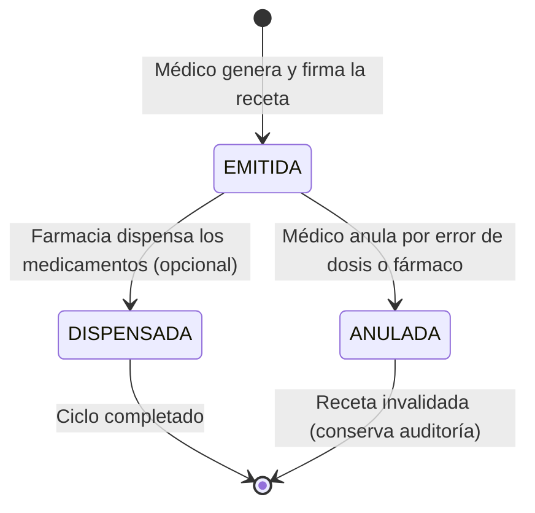

# 05. Módulo de Recetas y Documentos Médicos — Arquitectura y Diseño Técnico

Este documento detalla la arquitectura, el modelo de datos relacional, las pautas farmacológicas y el marco de seguridad médico-legal para el **Módulo de Recetas y Prescripciones Médicas Digitales** de la plataforma clínica SaaS.

---

## 1. Alcance y Objetivos del Módulo

El módulo de Recetas Médicas digitaliza la emisión, control y entrega de prescripciones farmacológicas. En la práctica clínica, la receta es el documento oficial mediante el cual el facultativo autoriza y guía el tratamiento de un paciente.

Sus objetivos fundamentales son:

1. **Prescripción Farmacológica Estructurada:** Cada medicamento se registra de forma atómica y estandarizada: fármaco (principio activo o marca), presentación farmacéutica, dosis, vía de administración, frecuencia, duración e indicaciones de consumo.
2. **Vinculación con el Acto Médico (Consulta):** Capacidad de asociar la receta directamente a una `Consulta` clínica (`consultaId`), o emitirla de forma autónoma (recetas de repetición para pacientes crónicos).
3. **Numeración y Folio Consecutivo por Tenant:** Generación de un código o número de folio único por clínica (ej. `REC-2026-000001`), facilitando el control administrativo, la trazabilidad en farmacias y la prevención de falsificaciones.
4. **Inmutabilidad y Firma Profesional:** Registro de la matrícula profesional del médico emisor, fecha y hora de emisión, y fecha de vigencia del documento.
5. **Preparación para Generación de PDF (Tarea 23):** Estructura de datos optimizada en PostgreSQL 18 para renderizar instantáneamente recetas imprimibles con membrete de la clínica, firma y código de barras/QR de verificación.
6. **Aislamiento Multi-Tenant Estricto:** Toda receta pertenece a un `consultorioId`. Los pacientes y médicos de una clínica jamás son visibles ni accesibles para otra.

---

## 2. Modelo de Datos de la Entidad `Receta`

La entidad `Receta` hereda de `TenantBaseEntity`:
- Clave primaria `id` (UUID v4).
- Clave foránea `consultorioId` (UUID) vinculada a la clínica.
- Marcas de auditoría temporal `creadoEn` y `actualizadoEn`.

### 2.1 Campos y Tipos de Datos

| Campo | Tipo PostgreSQL | Requerido | Descripción |
| :--- | :--- | :--- | :--- |
| `id` | `uuid` | Sí | Clave primaria generada automáticamente (UUID v4). |
| `consultorio_id` | `uuid` | Sí | Clínica u organización emisora (`TenantBaseEntity`). |
| `paciente_id` | `uuid` | Sí | Paciente que recibe la prescripción (`FK pacientes.id`). |
| `profesional_id` | `uuid` | Sí | Médico que emite y firma la receta (`FK usuarios.id`). |
| `consulta_id` | `uuid` | No | Consulta clínica origen (`FK consultas.id`, nullable). |
| `numero_receta` | `varchar(50)` | Sí | Folio correlativo único dentro de la clínica (ej. `REC-000001`). |
| `fecha_emision` | `timestamp with time zone` | Sí | Momento exacto de emisión de la prescripción. |
| `fecha_vencimiento` | `date` | No | Fecha límite de validez para dispensación en farmacia. |
| `estado` | `varchar(30)` | Sí | Estado del documento (`EstadoReceta`, default `EMITIDA`). |
| `diagnostico_referencia` | `varchar(255)` | No | Diagnóstico o código CIE-10 justificado para el tratamiento. |
| `medicamentos` | `jsonb` | Sí | Lista estructurada de fármacos prescritos (array de objetos). |
| `indicaciones_generales` | `text` | No | Recomendaciones no farmacológicas, advertencias y dieta. |
| `motivo_anulacion` | `text` | No | Justificación en caso de anulación administrativa o clínica. |
| `creado_en` | `timestamp with time zone` | Sí | Auditoría de creación en base de datos. |
| `actualizado_en` | `timestamp with time zone` | Sí | Auditoría de última modificación. |

### 2.2 Estructura Atómica del Fármaco (`medicamentos` JSONB)

Cada elemento del array `medicamentos` contiene:

```typescript
interface MedicamentoReceta {
  medicamento: string;    // Nombre comercial o principio activo (ej. "Amoxicilina + Ácido Clavulánico")
  presentacion: string;   // Concentración y forma (ej. "Comprimidos 875/125 mg", "Jarabe 250mg/5ml")
  dosis: string;          // Cantidad por toma (ej. "1 comprimido", "5 ml")
  via: string;            // Vía de administración (ej. "Oral", "Tópica", "Oftálmica", "Inhalatoria")
  frecuencia: string;     // Intervalo horario (ej. "cada 8 horas", "cada 12 horas", "cada 24 horas")
  duracion: string;       // Plazo de administración (ej. "por 7 días", "por 1 mes", "uso continuo")
  indicaciones: string;   // Instrucciones específicas (ej. "Tomar inmediatamente después del desayuno")
  cantidad: number;       // Cantidad de envases o unidades a despachar en farmacia (ej. 2 cajas)
}
```

*Ventaja de `jsonb` en PostgreSQL 18:* Garantiza atomicidad absoluta (la receta se guarda en una sola transacción sin joins complejos de 1 a N), soporte para búsquedas indexadas y serialización directa para la plantilla del PDF.

---

## 3. Estados de la Receta (`EstadoReceta`)



1. **`EMITIDA`**: Prescripción válida, activa y legalmente apta para ser impresa, enviada al paciente o dispensada en farmacia.
2. **`DISPENSADA`**: Marcador opcional de seguimiento cuando la farmacia entrega los medicamentos.
3. **`ANULADA`**: Prescripción invalidada (ej. por detección de alergia tardía, ajuste de dosis o error en el fármaco). Requiere `motivoAnulacion`.

---

## 4. Estrategia de Folio Único por Consultorio (`numeroReceta`)

Para garantizar folios consecutivos limpios e independientes entre clínicas:
- Formato estándar: `REC-{YYYY}-{CORRELATIVO}` (ej. `REC-2026-000001`).
- Índice único compuesto: `(consultorio_id, numero_receta)` asegura que la numeración sea consecutiva e independiente para cada consultorio sin colisiones.

---

## 5. Índices de Alto Rendimiento en PostgreSQL 18

1. **Historial de Recetas del Paciente:**
   ```sql
   CREATE INDEX idx_recetas_consultorio_paciente 
   ON recetas (consultorio_id, paciente_id, fecha_emision DESC);
   ```
2. **Auditoría de Emisiones por Médico:**
   ```sql
   CREATE INDEX idx_recetas_consultorio_profesional 
   ON recetas (consultorio_id, profesional_id, fecha_emision DESC);
   ```
3. **Búsqueda Rápida por Folio:**
   ```sql
   CREATE UNIQUE INDEX idx_recetas_consultorio_numero 
   ON recetas (consultorio_id, numero_receta);
   ```
4. **Búsqueda por Consulta Vinculada:**
   ```sql
   CREATE INDEX idx_recetas_consultorio_consulta 
   ON recetas (consultorio_id, consulta_id);
   ```
5. **Auditoría Temporal de la Clínica:**
   ```sql
   CREATE INDEX idx_recetas_consultorio_fecha 
   ON recetas (consultorio_id, fecha_emision DESC);
   ```

---

## 6. Fases del Módulo de Recetas y Documentos (Roadmap)

- **Tarea 22 (Roadmap 22)**: Diseñar módulo de recetas (Arquitectura, modelo `Receta`, interfaz farmacológica, estados e índices).
- **Tarea 23 (Roadmap 23)**: Implementar generación de PDF para impresión y descarga de recetas médicas oficiales.
- **Tarea 24 (Roadmap 24)**: Implementar almacenamiento de archivos y documentos clínicos.
- **Tarea 25 (Roadmap 25)**: Implementar adjuntos por paciente y consulta (estudios de laboratorio, imágenes, ecografías).
