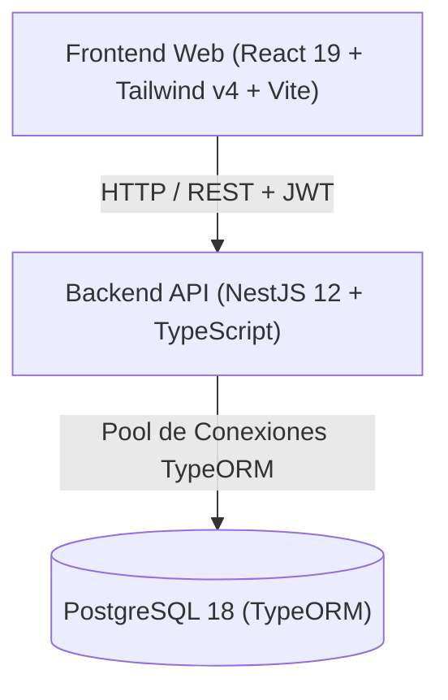
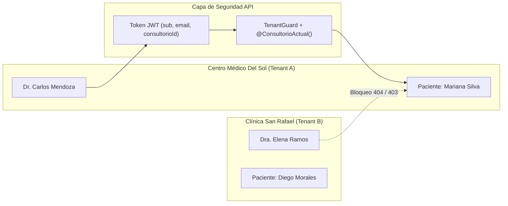

# Informe Técnico Ejecutivo — Plataforma SaaS Sistema Clínico

**Fecha:** 4 de Septiembre de 2026  
**Proyecto:** Sistema Clínico — Plataforma SaaS Multi-Tenant para Gestión Médica  
**Repositorio:** [github.com/RaldyXs/Sistema-clinico](https://github.com/RaldyXs/Sistema-clinico)  
**Versión de Entrega:** Fase 1 y Fase 2 (100% Completadas) + Fase 3 (Arquitectura Base Creada)  

---

## 1. Resumen Ejecutivo

El proyecto consiste en el desarrollo de un **SaaS Clínico Integral Multi-Tenant** diseñado para consultorios, policlínicas y centros médicos independientes. Su arquitectura está construida de forma desacoplada y genérica, permitiendo que el núcleo del sistema pueda adaptarse en el futuro a otras verticales de negocio (veterinarias, centros de estética, consultoría profesional) sin reescribir la base del software.

Hasta el momento se han completado y validado en producción local las dos primeras fases críticas del sistema:
- **Fase 1 (Fundamentos & Seguridad)**: Autenticación JWT, RBAC granular con 14 permisos, entidades de organización y aislamiento multi-tenant estricto.
- **Fase 2 (Pacientes)**: Registro, edición, búsqueda multi-criterio, paginación, alertas médicas y ficha clínica 360° con cálculo temporal exacto de edad.
- **Fase 3 (Citas y Agenda)**: Arquitectura relacional, máquina de estados clínicos y 4 índices de alto rendimiento en PostgreSQL 18 implementados.

---

## 2. Ficha Técnica y Stack de Tecnologías

| Capa | Tecnologías Seleccionadas | Razón de Elección Técnica |
| :--- | :--- | :--- |
| **Monorepo** | npm workspaces | Permite compartir tipos y contratos entre frontend y backend manteniendo un versionado unificado. |
| **Backend** | NestJS 12 + TypeScript (Node.js) | Arquitectura modular orientada a inyección de dependencias, DTOs tipados y fácil mantenimiento empresarial. |
| **Persistencia** | PostgreSQL 18.6 + TypeORM | Motor relacional robusto con soporte nativo para UUIDs, marcas temporales con huso horario (`timestamptz`) e índices compuestos btree. |
| **Seguridad** | Passport + JWT + Bcryptjs | Firma de tokens con expiración, almacenamiento seguro de hashes de contraseña y Guards de autorización. |
| **Control de Calidad** | Oxlint + TypeScript Compiler | Análisis estático ultrarrápido (0 errores de linting, 0 advertencias) y compilación limpia en menos de 1 segundo. |
| **Frontend** | React 19, Tailwind CSS v4, Lucide | Interfaz moderna, reactiva, preparada para integración con componentes Shadcn UI. |

---

## 3. Arquitectura de Seguridad y Aislamiento Multi-Tenant

Uno de los principales retos superados es el **aislamiento estricto de datos** entre distintas organizaciones que comparten la misma base de datos (Shared Database, Shared Schema):

1. **`TenantBaseEntity`**: Clase abstracta heredada por todas las entidades del negocio (`Paciente`, `Cita`, etc.) que inyecta automáticamente `id` (UUID v4), `consultorio_id` y marcas de auditoría temporal (`creadoEn`, `actualizadoEn`).
2. **Inyección en Tiempo de Ejecución (`@ConsultorioActual()`)**: El ID del consultorio nunca se acepta como parámetro manipulable por el usuario en el cuerpo de la petición; se extrae de forma criptográfica del token JWT autenticado.
3. **Validación Cruzada**: Intentos de acceso o modificación de registros entre organizaciones diferentes devuelven `404 Not Found` (para evitar fuga de información por enumeración) o `403 Forbidden`.

---

## 4. Estado de Avance por Fases

### 🟢 Fase 1 — Fundamentos y Seguridad (100% Completada)
- **Monorepo y Estructura de Proyecto**: Configuración de `apps/web`, `apps/api`, scripts unificados y control de versiones.
- **Modelo Organizacional**: Entidad `Consultorio` como raíz del Tenant.
- **Autenticación**: Registro de clínicas y usuarios, login con bcrypt, emisión y validación de JWT con firma secreta.
- **Control de Acceso Basado en Roles (RBAC)**:
  - Desacoplamiento de roles de infraestructura (`ADMIN`) de roles operativos clínicos (`PROFESIONAL_SALUD`, `RECEPCION`).
  - Matriz de 14 permisos granulares (`pacientes:*`, `citas:*`, `consultorios:*`, etc.) con tabla pivote `roles_permisos`.

### 🟢 Fase 2 — Módulo de Pacientes (100% Completada)
- **Modelo Relacional de Filiación y Datos Clínicos**:
  - Entidad `Paciente` con 20 campos (nombres, documento, fecha de nacimiento, contacto, alertas de alergias, antecedentes médicos y personales, contacto de emergencia).
  - Índice compuesto único `[consultorio_id, documento_identidad]`: Permite que dos pacientes en clínicas distintas puedan tener el mismo número de cédula o DNI sin conflicto, garantizando unicidad dentro de cada clínica.
- **CRUD Seguro con DTOs y Validación**:
  - `POST /pacientes`: Alta de paciente con sanitización y rechazo automático de duplicados (`409 Conflict`).
  - `PATCH /pacientes/:id`: Actualización parcial de datos de contacto o clínicos.
  - Soft-delete: La información médica nunca se elimina físicamente de la base de datos (`activo: boolean`) para cumplir normativas sanitarias.
- **Motor de Búsqueda y Paginación**:
  - `GET /pacientes`: Búsqueda multi-campo insensible a mayúsculas/minúsculas (`termino`) sobre nombres, apellidos, documento y teléfono.
  - Filtros clínicos combinables por género y grupo sanguíneo con metadatos completos de paginación (`total`, `totalPaginas`, `pagina`, `limite`).
- **Ficha Médica 360°**:
  - `GET /pacientes/:id/ficha`: Vista consolidada del paciente.
  - **Algoritmo Clínico de Edad**: Cálculo dinámico exacto de edad (años, meses y días) considerando años bisiestos y longitudes de mes para prescripción pediátrica y geriátrica.
  - **Badges de Alerta Médica**: Detección y clasificación automática de alergias críticas con nivel de severidad `ALTA`.

### 🟡 Fase 3 — Citas y Agenda (En Progreso — 25%)
- **Diseño Relacional & Arquitectura (Tarea 12 Completada)**:
  - Documento de especificación técnica `docs/03-Citas.md`.
  - Entidad `Cita` creada con claves foráneas protegidas (`RESTRICT`) hacia `Paciente` y `Usuario` (médico).
  - Tipos temporales nativos con zona horaria (`timestamp with time zone`).
  - **Máquina de Estados Clínicos de 7 fases**: `PROGRAMADA` → `CONFIRMADA` → `EN_ESPERA` → `EN_CONSULTA` → `ATENDIDA` (más estados terminales `CANCELADA` y `NO_ASISTIO`).
  - **Optimización de Índices en PostgreSQL 18**:
    1. `idx_citas_consultorio_inicio`: Consultas de agenda diaria y semanal.
    2. `idx_citas_profesional_agenda`: Verificación instantánea de solapamiento de horarios por médico.
    3. `idx_citas_paciente_historial`: Historial cronológico de atenciones para la ficha médica.
    4. `idx_citas_consultorio_estado`: Gestión de sala de espera en recepción.

---

## 5. Pruebas y Aseguramiento de Calidad Realizadas

Todas las funcionalidades descritas cuentan con validación técnica comprobada:

1. **Pruebas de Inyección y Validación de Datos**:
   - Comportamiento verificado ante cargas incompletas o tipos erróneos devolviendo `400 Bad Request` con mensajes detallados de `class-validator`.
2. **Pruebas de Concurrencia y Aislamiento**:
   - Verificado el aislamiento entre dos consultorios reales de prueba (`Centro Médico del Sol` y `Clínica San Rafael`). Un médico del Consultorio B intentando consultar una ficha o editar un paciente del Consultorio A recibe un rechazo inmediato `404 Not Found`.
3. **Compilación y Linters**:
   - `npm run lint`: **0 errores, 0 advertencias**.
   - `npm run build`: **Compilación exitosa en 853 ms**.
4. **Sincronización de Base de Datos**:
   - 7 tablas maestras operativas en PostgreSQL 18 (`consultorios`, `usuarios`, `roles`, `permisos`, `roles_permisos`, `pacientes`, `citas`) con integridad referencial completa y llaves foráneas activas.

---

## 6. Próximos Pasos en el Plan de Trabajo

Al retomar la actividad técnica, los siguientes pasos calendarizados son:

| Tarea | Roadmap | Descripción |
| :--- | :--- | :--- |
| **Creación y Edición de Citas** | Tarea 13 | DTOs de agenda, endpoints `POST /citas` y `PATCH /citas/:id` con algoritmo anti-solapamiento de horarios médicos. |
| **Flujo de Estados Clínicos** | Tarea 14 | Endpoints para recepción y médico (marcar llegada a sala de espera, inicio de consulta y finalización). |
| **Vistas de Agenda y Calendario** | Tarea 15 | Endpoint de consulta por rango de fechas (vista diaria/semanal), médico y estado de sala de espera. |
| **Fase 4: Historia Clínica** | Tarea 16+ | Registro médico, evolución, signos vitales, diagnósticos CIE y prescripción farmacológica. |

---

> **Documentación viva:** Para auditoría detallada de código, consultar los archivos en el repositorio local:
> - `docs/01-Fundamentos.md`
> - `docs/02-Pacientes.md`
> - `docs/03-Citas.md`
> - `docs/PROJECT_STATUS.md`
